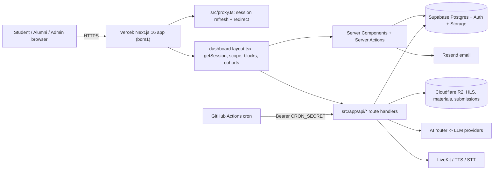

> **SUPERSEDED on 2026-11-14.** Use docs/README.md and docs/architecture/OVERVIEW.md instead. This file is kept for history and may be out of date. Index of current docs: docs/README.md.

# VIBHA LMS — Master Architecture (Single Source of Truth)

> **Verified against:** `main` @ `b2a9698` (PR #45), audited 2026-11-06. Read-only audit — no application code, schema or configuration was changed.
> **Status legend used everywhere in `docs/`:**
> `VERIFIED` = read in the source at the cited path · `INFERRED` = deduced from code, not run · `UNVERIFIED` = could not be established from the repo (needs a human or DB/dashboard check) · `PROPOSED` = not built · `HISTORICAL` = no longer current.

## 1. What the platform is
**VIBHA School of Psychology — "PLMS"** is an invitation-only clinical-psychology training LMS built on one Next.js codebase. It has two surfaces (`VERIFIED`, `src/app`):
- a **public site** (landing, waitlist, policies, certificate verification, free tools), and
- the **authenticated app** under `src/app/(dashboard)` — student, alumni and admin experiences.

There is **no public sign-up**: admins create accounts via roster import; students set their own password from a one-time link (`src/lib/auth/roster.ts`). There is **no payment/checkout system** in the code (see [Technical debt → "no payments"](inventory/TECHNICAL_DEBT.md)); enrolment is admin-driven.

## 2. Technology stack (`package.json`)
| Layer | Technology |
|---|---|
| Framework | Next.js `^16.4.3` (App Router, Turbopack), React `19.2.4`, TypeScript 5. **`src/proxy.ts` replaces `middleware.ts`** (Next 16) — it is deliberately thin |
| Styling/UI | Tailwind v4, Radix UI, lucide-react, motion, sonner; "Neo-Brutalist Pastel" design system (`/vibha-design` skill, `docs/UI_RULES.md`) |
| Data/Auth | Supabase (Postgres + RLS + Auth) via `@supabase/ssr`; service-role client for server work |
| Video/media | Cloudflare R2 (S3 API) for HLS + AES-128; Supabase Storage as alternate provider; `hls.js` player |
| Email | Resend (direct `fetch`) + Svix-signed webhook |
| AI | Multi-provider router (Groq → Cerebras → SambaNova → Gemini → OpenRouter → OpenCode → OmniRoute → DeepSeek → Anthropic) |
| Realtime voice | LiveKit (`livekit-agent/`) |
| Observability | Sentry, PostHog, Vercel Analytics/Speed Insights |
| Hosting | Vercel (region `bom1`), GitHub Actions for cron/backup/CI |
| Tests | Vitest (156 test files in `src`+`e2e`), Playwright e2e |

## 3. Components at a glance

(Detail: [SYSTEM_ARCHITECTURE](architecture/SYSTEM_ARCHITECTURE.md).)

## 4. Where to look (index)
| Topic | Document |
|---|---|
| System, frontend, backend | [SYSTEM_OVERVIEW](architecture/SYSTEM_OVERVIEW.md) · [SYSTEM_ARCHITECTURE](architecture/SYSTEM_ARCHITECTURE.md) · [FRONTEND](architecture/FRONTEND_ARCHITECTURE.md) · [BACKEND](architecture/BACKEND_ARCHITECTURE.md) |
| Data & API | [DATABASE](architecture/DATABASE_ARCHITECTURE.md) · [API](architecture/API_ARCHITECTURE.md) |
| Infra & security | [INFRASTRUCTURE](architecture/INFRASTRUCTURE.md) · [SECURITY](architecture/SECURITY_ARCHITECTURE.md) |
| Modules | [Authentication](modules/AUTHENTICATION.md) · [LMS, cohorts & access](modules/LMS.md) · [Video](modules/VIDEO_SYSTEM.md) · [Student dashboard](modules/STUDENT_DASHBOARD.md) · [Admin dashboard](modules/ADMIN_DASHBOARD.md) · [Quizzes & assessments](modules/QUIZZES.md) · [Practice & AI](modules/PRACTICE_AND_AI.md) · [Certificates](modules/CERTIFICATES.md) · [Notifications](modules/NOTIFICATIONS.md) |
| Workflows | [Student lifecycle](workflows/STUDENT_LIFECYCLE.md) · [Enrolment](workflows/ENROLLMENT_FLOW.md) · [Video processing](workflows/VIDEO_PROCESSING.md) · [Assessment](workflows/ASSESSMENT_FLOW.md) · [Certificate](workflows/CERTIFICATE_FLOW.md) |
| Inventories | [Features](inventory/FEATURE_INVENTORY.md) · [API](inventory/API_INVENTORY.md) · [Database](inventory/DATABASE_INVENTORY.md) · [Integrations](inventory/INTEGRATION_INVENTORY.md) · [Unused/uncertain](inventory/UNUSED_FEATURES.md) · [Technical debt](inventory/TECHNICAL_DEBT.md) |
| Design (mandatory for UI work) | [Design intelligence](design/DESIGN_INTELLIGENCE.md) · [**Decision framework (25 questions)**](design/DECISION_FRAMEWORK.md) · [Research references](design/RESEARCH_REFERENCES.md) · [UI rules](UI_RULES.md) |
| History & rules | [Development history](history/DEVELOPMENT_HISTORY.md) · [Decisions](history/ARCHITECTURAL_DECISIONS.md) · [Changelog](changes/CHANGELOG.md) · [**Change policy**](changes/DOCUMENTATION_CHANGE_POLICY.md) |

Pre-existing flat docs in `docs/` (e.g. `SYSTEM_MAP.md`, `COHORTS.md`, `SECURITY_AUDIT.md`, `DEPLOYMENT_GUIDE.md`, `ENVIRONMENT_VARIABLES.md`) were **left untouched**. Where they conflict with this knowledge base, **the source code wins, then this knowledge base, then those files** — conflicts found are listed in [TECHNICAL_DEBT §Documentation drift](inventory/TECHNICAL_DEBT.md).

## 5. Scale (counted on `main` @ `b2a9698`)
113 `page.tsx` routes · 77 `route.ts` handlers · ~22 server-action files · 156 test files · 74 SQL files (1 `schema.sql` + 44 in `supabase/migrations_pending` + 29 in `src/migrations_pending`) · 8 GitHub workflows · ~100 tables/views referenced from code.

## 6. Critical dependencies
Supabase (auth + data — single point of failure) · Cloudflare R2 (all lecture video) · Vercel (hosting) · Resend (credentials/mail) · at least one LLM provider key for Practice/Sim · `SESSION_SECRET` (stream tokens) · `CRON_SECRET` (cron endpoint). See [INTEGRATION_INVENTORY](inventory/INTEGRATION_INVENTORY.md).

## 7. Known limitations & unresolved questions (summary — details in TECHNICAL_DEBT / UNUSED_FEATURES)
1. **Migrations are not applied by tooling in the repo** — all SQL sits in two `*migrations_pending` folders; which are applied to production is `UNVERIFIED`. `page_visits` (used by `/api/visit`) has **no DDL anywhere in the repo**.
2. **Daily reminders email is a stub** — cron task `send-reminders` records `not_configured` and sends nothing (`src/app/api/internal/cron/route.ts`).
3. **Certificate PDF uses the student's e-mail as the printed name** (`admin/students/certificate-action.ts`).
4. **No payments** — if payments are expected, this is `G` (planned/not built).
5. Large Practice/Sim/AI surface with many feature flags; actual production flag states are `UNVERIFIED` (stored in DB table `feature_flags`).
6. Cohort model is new (Nov 2026); production data migration status of `2026_11_cohorts.sql` is `UNVERIFIED`.

## 7b. In progress (not on `main` yet)
Branch **`admin-redesign`** (built on `testing`): the full admin dashboard redesign — see [ADMIN_REDESIGN_PLAN](plans/ADMIN_REDESIGN_PLAN.md), [ADMIN_DASHBOARD](modules/ADMIN_DASHBOARD.md), [NOTIFICATIONS](modules/NOTIFICATIONS.md). Needs DB step `2026_11_admin_redesign.sql`.

## 8. How to change this system
Follow [DOCUMENTATION_CHANGE_POLICY](changes/DOCUMENTATION_CHANGE_POLICY.md): read this file → read the module doc → check dependencies → propose → implement after approval → verify → update docs + CHANGELOG.
