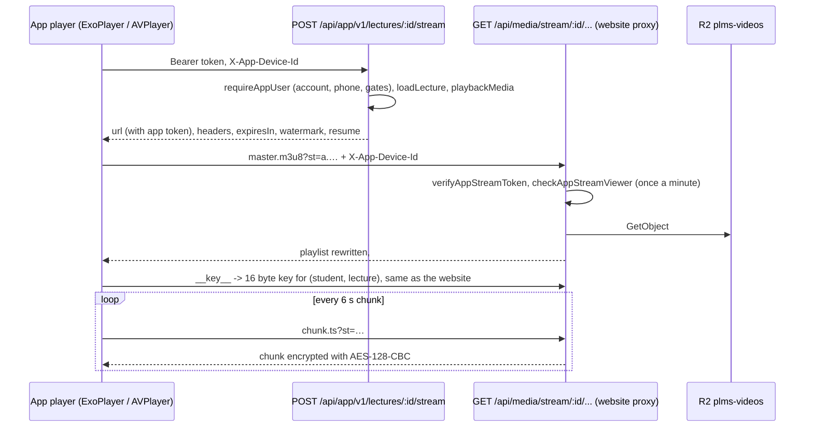

# App video delivery

How the Vibha Psychology app plays lectures today, and the planned move to serving video chunks straight from Cloudflare. Last updated 2026-11-15.

## Today: through the website's stream proxy (built)

What is the same as the website, by construction (it is the same code after the viewer check):

- The playlists, the quality ladder (1080p down to 240p or 360p), the 6 second chunks.
- AES-128 on the way out, IV = media sequence number.
- The key: `deriveSessionKey(studentId, lessonId)` in `src/lib/media/crypto.ts`. A chunk copied off one phone is useless to any other student.
- The enrolment and publish verdict (`authorizeAndResolveLesson`), cached per viewer and lecture.
- The rate limits per student and per network.

What is different for the app, and why:

| | Website | App |
|---|---|---|
| Token | `stream-token.ts`, 5 minutes, swapped by hls.js during playback | `app-stream-token.ts`, one and a half times the lecture plus 10 minutes (30 minutes to 6 hours). A native player keeps the addresses of the playlist it loaded and cannot swap tokens inside them |
| Signing key | HMAC of `SESSION_SECRET` with context `plms-stream-v1` | Same secret, context `plms-stream-app-v1`: neither kind passes the other's check |
| Who is watching | The browser session cookie (or the cookie bound fast path) | The token's student and phone, re-checked at most once a minute: not paused, not ended, phone still the signed-in one (`checkAppStreamViewer`) |
| Bound to | Student, lecture, course | Student, lecture, course, and a hash of the phone id. With `bindHeader` (the default) every request must carry the same `X-App-Device-Id` |
| Lecture rows read with | The student's own database client (row level security) | The service role, so the lecture's `hidden` / not-yet-live status is checked in code instead |
| Verdict cache entry | `uid:lessonId` | `app:uid:lessonId` (the app never moves the website's cookie fast path) |

The watermark text (name and roll number) comes in `StreamAccess.watermark`; the app draws it moving over the video. Screen capture is blocked on Android (FLAG_SECURE) and detected on iPhone by the app.

Cost: every chunk still passes through a Vercel function, exactly like the website. That is the reason for the plan below.

## Planned: chunks straight from Cloudflare (not built)

Goal: the app (and later the website) gets chunks from Cloudflare's edge, not through Vercel, without weakening any of the rules above.

Design:

1. A Cloudflare Worker on a video subdomain (for example `v.vibhapsychology.com`) with the R2 bucket `plms-videos` bound to it. No public bucket access.
2. The website keeps minting the token. The Worker gets a verify-only key: a separate secret `VIDEO_EDGE_SECRET` shared by Vercel and the Worker, used only for a third token kind (`plms-stream-edge-v1`). `SESSION_SECRET` never leaves Vercel.
3. The playlists stay on the website proxy (they are small and they carry the token and the key line). Only the chunk lines are rewritten to the Worker address, each with the edge token.
4. The key endpoint stays on the website proxy: the key is never computed outside Vercel.
5. The Worker, per chunk: checks the edge token (signature, expiry, lecture prefix), checks `X-App-Device-Id` against the token's phone hash, fetches the plain chunk from R2, and encrypts it with the same key. Problem: the Worker would need the key. Two ways:
   - a. The Worker derives the key itself: needs `SESSION_SECRET`. Rejected (one secret in two places, and a Worker leak gives every key).
   - b. The token carries the 16 byte key encrypted to the Worker (`AES-GCM` with `VIDEO_EDGE_SECRET`). The Worker decrypts it per request. A leaked Worker secret exposes keys only for tokens that are still alive, never the master secret. **Chosen.**
6. Account and phone re-checks: the Worker cannot read the database, so the edge token is short (10 minutes). It travels in a header (`X-Video-Token`), not in the chunk address, and the app's player fills that header from the latest token on every request (ExoPlayer `ResolvingDataSource` on Android, `AVAssetResourceLoaderDelegate` on iPhone). The app asks `/stream` for a fresh edge token every 5 minutes; `/stream` runs the full account and phone check. So a paused student or a replaced phone stops within 10 minutes instead of 1. This needs a small player change in the app, made at the same time.
7. Rate limits move to Cloudflare (per token and per network), the website keeps its own on playlists and keys.
8. Switch: a flag `video_edge` (off, on for app, on for all). Off keeps today's proxy unchanged. `StreamAccess` gets an optional `edge` field (token and refresh interval); an app that does not know it keeps using the proxy address.

Before building it, the owner decides: the video subdomain, adding the Worker to the Cloudflare account, and whether a 10 minute stop window (instead of 1 minute) is acceptable.

## Files

- `src/lib/media/app-stream-token.ts`: the app token.
- `src/lib/media/app-viewer.ts`: the once-a-minute account and phone check.
- `src/lib/app-api/stream.ts`: `POST /api/app/v1/lectures/:id/stream`.
- `src/app/api/media/stream/[...lessonId]/route.ts`: the proxy, with the app branch at the top.
- `src/lib/media/playback.ts`: media type and resume position, shared with `/api/media/playback`.
