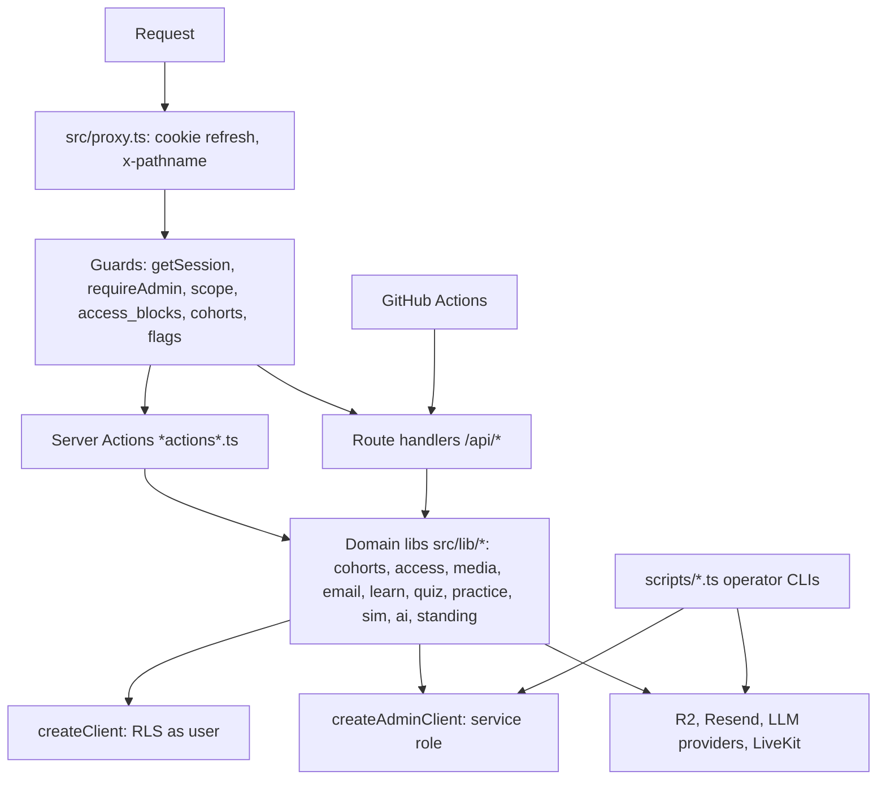

> **SUPERSEDED on 2026-11-14.** Use docs/architecture/BACKEND.md instead. This file is kept for history and may be out of date. Index of current docs: docs/README.md.

# Backend Architecture
> Verified against `main` @ `b2a9698`. There is no separate backend service: the backend is Next.js server code + Supabase.

## Layers
1. **`src/proxy.ts`** — thin: refresh Supabase cookie, set `x-pathname`, redirect unauthenticated users, markdown content-negotiation for `/`.
2. **Guards** (`src/lib/auth/*`): `getSession()` (authoritative: blocked → expired → single-session token), `requireSession/requireAdmin` for Server Actions, `api-guard.ts`/`api-gate.ts` for route handlers, `scope.ts` (lectures-only allow-list), `master*.ts` (support key).
3. **Domain libraries** (`src/lib/*`): `cohorts` (who can watch), `access` (per-student blocks/resets), `media` (R2/Supabase providers, stream tokens), `email`, `crm`, `learn` (Notes/Games engine, XP, leaderboard), `quiz`, `practice`, `sim` (patient simulator), `ai` (router, scoring, cache), `voice`, `knowledge` (RAG), `psychopharm`/`meds`, `standing` (points/levels), `doubts`, `people` (presence, hidden accounts), `certificate.ts`, `reminders.ts`.
4. **Data access**: `createClient()` (RLS, user cookie) vs `createAdminClient()` (service role) in `src/lib/supabase/server.ts`.
5. **Scheduled work**: GitHub Actions → `GET /api/internal/cron?task=` (Bearer `CRON_SECRET`, fail-closed).
6. **Workers**: `livekit-agent/agent.ts` (voice agent, separate process, `npm run livekit:worker`); Chatterbox TTS server (`scripts/chatterbox-server`, docs/CHATTERBOX_*).
7. **Operational scripts** (`scripts/*`, run with `tsx`): publish lectures, R2 migrate/verify/rotate, restore/verify backup, roster import, seeds, corpus/knowledge ingestion.

## Authorization model (summary)
`role` (admin/student/alumni) × `status` (active/blocked) × `scope` (full/lectures_only) × `access_blocks` (feature keys) × cohort membership (lecture visibility) × feature flags (`off/live/unlocked`). Order of checks and code paths: [AUTHENTICATION](../modules/AUTHENTICATION.md), [LMS](../modules/LMS.md).

## Service-role usage
`createAdminClient()` bypasses RLS and is used widely (a prior audit counted 62 files on 2026-08-14, `docs/SECURITY_AUDIT.md` — count is `HISTORICAL`). Ownership checks in those routes are therefore load-bearing; see [SECURITY_ARCHITECTURE](SECURITY_ARCHITECTURE.md).

## Backend layering diagram

