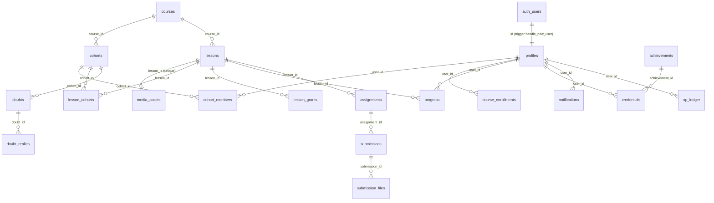

# Database

Supabase Postgres 17, project `hojhzwvuccojqkvkkslw` (name `plms`), region ap-south-1 (Mumbai), **Free plan**. Facts below come from read-only queries on 2026-11-14.

## Size

- About 170 tables in `public`, 6 views, 31 app functions, 22 triggers.
- Database size 210 MB of the 500 MB Free plan limit. 147 MB of that is `corpus_chunks` (the book text and its vector embeddings for the knowledge tutor, which is switched off).
- Every table has row level security turned on.
- Extensions in use: `vector` (embeddings, `halfvec`), `pg_trgm` (text search), `pg_stat_statements`.

## Tables by domain

| Domain | Main tables |
|---|---|
| People and access | `profiles` (one per `auth.users` row: role, scope, status, expiry, session token, roll number), `student_details`, `app_roles`, `access_blocks`, `account_setup_tokens`, `credential_invites`, `device_setup_codes`, `master_login_events`, `admin_settings`, `admin_audit_log` |
| Cohorts and courses | `courses`, `lessons`, `media_assets`, `lesson_transcripts`, `transcript_chunks`, `course_enrollments`, `cohorts`, `cohort_members`, `lesson_cohorts`, `lesson_grants`, `lesson_share_links`, `modules`, `module_items`, `module_access` |
| Lecture progress | `progress` (user, lesson, watched seconds, done), `attention_checks`, `page_visits` |
| Assignments | `assignments`, `submissions`, `submission_files`, `materials` |
| Achievements and certificates | `achievements`, `credentials`, `certificates` |
| Study and exam prep | `learn_progress`, `learn_events`, `skill_state`, `item_stats`, `placement`, `confusions`, `study_marks`, `answer_history`, `prep_answers`, `prep_seen`, `prep_profile`, `prep_mock_attempts`, `prep_interview_sessions`, `review_cards`, `tip_dismissals`, `hint_ledger` |
| Games and standing | `xp_ledger`, `blitz_results`, `sort_results`, `daily_case_results`, `games2_results`, `games2_teams`, `games2_team_members`, `games2_votes`, `matches`, `match_answers`, `ratings`, `league_weeks`, `standing_snapshots`, `streaks`, `streak_repairs`, `quests`, `quest_progress`, `cohort_goals`, `cohort_goal_progress` |
| Doubts and messages | `doubts`, `doubt_replies`, `doubt_votes`, `doubt_followups`, `doubts_legacy` (old table, kept), `notifications` |
| Email and CRM | `email_sends`, `email_campaigns`, `email_inbound`, `contacts`, `crm_contacts`, `crm_activities`, `enquiries`, `link_forms`, `link_form_submissions` |
| Practice layer (mostly flag off) | `sim_cases`, `sim_sessions`, `sim_turns`, `sim_scores`, `sim_branches`, `sim_interview_grades`, `scoring_corrections`, `calibration_pairs`, `rubric_dimensions`, `mse_stimuli`, `mse_attempts`, `mse_expert_codings`, `sct_items`, `sct_attempts`, `sct_expert_responses`, `sct_panel_members`, `osce_stations`, `osce_attempts`, `formulation_cases`, `formulation_attempts`, `formulation_wall_posts`, `competencies`, `competency_events`, `supervision_entries`, `journal_entries`, `journal_shares`, `checkins`, `pair_sessions`, `pair_messages`, `practice_chains`, `cards`, `card_reviews`, `idioms`, `quiz_attempts`, `wall_posts`, `wall_replies`, `wall_reactions`, `wall_reports`, `voice_sessions`, `voice_metrics`, `ai_cases`, `ai_case_flags` |
| Medicines (psychopharm) | `psych_drugs`, `psych_drug_fields`, `psych_dose_bands`, `psych_dose_ranges`, `psych_sources`, `psych_conditions`, `psych_*` (red flags, pearls, timeline, vignettes, observations, therapy planning and more), `medication_documents`, `medication_document_versions`, `psych_review_audit`, `psych_user_acknowledgements` |
| Knowledge layer | `corpus_sources`, `corpus_documents`, `corpus_chunks`, `knowledge_concepts`, `knowledge_chunk_concepts`, `style_patterns`, `rights_registry`, `library_notes`, `corpus_dictations` |
| Platform | `feature_flags`, `rate_limits`, `ai_usage_log`, `ai_response_cache`, `provider_health`, `infra_snapshots`, `_migrations_applied` |

Largest by rows (estimates): `knowledge_chunk_concepts` 37k, `corpus_chunks` 28k, `page_visits` 21k, `psych_drug_fields` 1.7k, `review_cards` 1.6k, `item_stats` 1.6k, `prep_answers` 1.4k, `email_sends` 1.3k. Everything else is under 1,200 rows.

## Key relationships

Who may watch a lecture is worked out in code from cohort membership, lesson sharing and single-lesson grants: `src/lib/cohorts/access.ts` and `src/lib/cohorts/rules.ts` (`canWatch`, `usesCohorts`).

## Row level security summary

- Own rows: most per-student tables allow a user to read and write rows where `user_id = auth.uid()`.
- Admin read: policies call `is_admin()` (super admin or view admin).
- Admin write: policies call `is_super_admin()`. View admins cannot write.
- Reference content (`psych_*`, `sim_cases`, `mse_stimuli`, `osce_stations`, `sct_items`): signed-in users read published or approved rows. Editors and reviewers are set in `app_roles`, read by `app_role()`.
- Anonymous posts: `wall_posts_visible`, `wall_replies_visible`, `formulation_wall_visible` views hide the author for anonymous rows.
- Server only (RLS on, no policies, so only the service-role client can reach them): `link_forms`, `link_form_submissions`, `contacts`, `email_campaigns`, `admin_settings`, `master_login_events`, `doubt_followups`, `device_setup_codes`, `lesson_share_links`, `_migrations_applied`.
- Column guards are triggers, not policies: `protect_profile_columns`, `protect_profile_rewards`, `protect_super_admin`, `protect_roll_number`, `protect_credential_id`, `protect_submission_grading`, `protect_supervision_signoff`. They stop a student from changing role, scope, status, expiry, rewards, grades or sign-offs.

Advisor findings on 2026-11-14: 123 policies re-evaluate `auth.uid()` per row (`auth_rls_initplan`, 82 tables), 78 tables have more than one permissive policy for the same action, 113 foreign keys have no index, 1 duplicate index. These matter little at 300 students but are listed in `docs/SCALABILITY_30_TO_300.md`.

## Functions (public schema)

`*` = security definer.

| Function | Purpose |
|---|---|
| `handle_new_user*` | Trigger on `auth.users`: creates the `profiles` row |
| `is_admin*`, `is_super_admin*`, `app_role*` | Role checks used by policies |
| `rate_limit_incr*` | Atomic counter for `src/lib/rate-limit.ts` |
| `standing_totals*` | Points totals for the standing job and leaderboard |
| `infra_metrics` | Usage numbers for `/admin/infra` |
| `match_corpus_chunks*`, `search_corpus_keyword*` | Vector and keyword search for the knowledge tutor |
| `publish_medication_document*` | Publishes a medicine page after checks |
| `assign_roll_number*`, `award_membership*` | Triggers on `profiles`: roll number and membership badge |
| `sync_lesson_video_path_on_hls` | Trigger: keeps `lessons.video_storage_path` in step with `media_assets` |
| `protect_*` | Column guards listed above |
| `touch_*`, `update_practice_chains_updated_at`, `touch_progress_updated_at` | `updated_at` maintenance |
| `medication_documents_demote*`, `psych_demote_on_published_edit*`, `med_docs_block_editor_publish*` | Review workflow for medicine pages |

## Migrations: how schema changes are made

There is no automatic migration runner on deploy.

- `supabase/schema.sql`: an old full schema snapshot. Not kept current. Do not apply it.
- `supabase/migrations_pending/`: 69 SQL files (plus the new `2026_11_14_scaling_indexes.sql`). Newer work.
- `src/migrations_pending/`: 29 SQL files. Older work.

How a change goes live:

1. Write an idempotent SQL file (`create ... if not exists`, guarded `do` blocks) in `supabase/migrations_pending/<yyyy_mm_dd>_<name>.sql`. Agents never write to the live database.
2. The owner reviews it and pastes it into the Supabase SQL editor, or runs `npx tsx scripts/apply-pending.ts <name>` (uses `SUPABASE_DB_PASSWORD`, applies files from `src/migrations_pending` and records them in `_migrations_applied`).
3. Deploy code that depends on the new schema after the SQL is in, unless the file's header says the order is the other way (for example `2026_11_14_security.sql`: code first).

Where applied state is recorded, and why it is unreliable:

- `supabase_migrations.schema_migrations`: 143 entries, written when SQL was applied through the Supabase tools. Names do not always match file names.
- `public._migrations_applied`: 20 entries, written by `scripts/apply-pending.ts`.
- Many files were pasted into the SQL editor, which records nothing.

So check the objects, not the logs. On 2026-11-14 every table created by any file in both pending folders exists in the live database, and all but 7 named indexes exist (6 `drug_id` indexes from `psychopharm_tools.sql`, now added in `2026_11_14_scaling_indexes.sql`, and `sim_scores_session_id_key`). The security fix `2026_11_14_security.sql` is applied (its triggers exist). In practice "pending" now means "kept for the record", except new files.

## Backups

Nightly `pg_dump` to R2 bucket `plms-backups` (`.github/workflows/backup.yml`), weekly restore test (`verify-backup.yml`), restore steps in `docs/RESTORE_RUNBOOK.md`. The Free plan has no point-in-time recovery.
