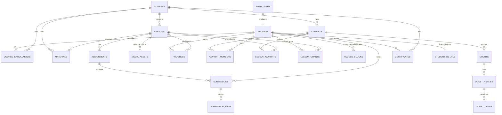

> **SUPERSEDED on 2026-11-14.** Use docs/architecture/DATABASE.md instead. This file is kept for history and may be out of date. Index of current docs: docs/README.md.

# Database Architecture
> Verified against `main` @ `b2a9698`. Engine: Supabase Postgres. Full table list: [DATABASE_INVENTORY](../inventory/DATABASE_INVENTORY.md).

## Where the schema lives (IMPORTANT)
There is **no `supabase/migrations/` folder and no applied-migration ledger in the repo.** DDL is spread over:
| Location | Files | Content |
|---|---|---|
| `supabase/schema.sql` | 1 (220 lines) | Core: `profiles`, `courses`, `lessons`, `progress`, `course_enrollments`, `app_roles`, `rate_limits`, auth trigger `handle_new_user`, `is_admin()` |
| `supabase/migrations_pending/` | 44 | Nov-2026 features (`2026_11_*.sql`: cohorts, learn, access/doubts, mail_clear, platform_rebuild…), materials/assignments/submissions, media_assets, certificates, email, credential invites, psychopharm, RLS hardening |
| `src/migrations_pending/` | 29 | "Practice layer": sim, flags, modules, wall, journal, checkins, knowledge, enquiries… |
Which of these are applied to production is **UNVERIFIED** (`scripts/apply-migrations.ts` / `apply-pending.ts` exist; see `docs/DEPLOYMENT_GUIDE.md`). `page_visits` is queried by `/api/visit` but has **no `CREATE TABLE` in the repo** (UNVERIFIED — may exist only in the live DB).

## Core relationship model (foreign keys read from the SQL)

Other table families (see inventory): Practice/Sim (`sim_cases/sessions/turns/scores`, `mse_*`, `osce_*`, `sct_*`, `formulation_*`, `competencies`), engagement (`wall_*`, `journal_*`, `checkins`, `cards/card_reviews`, `streaks`, `learn_progress`), knowledge/RAG (`corpus_*`, `knowledge_concepts`), psychopharm (`psych_*`, `medication_documents*`), ops (`feature_flags`, `modules/module_access`, `email_sends/email_inbound`, `credential_invites`, `account_setup_tokens`, `admin_settings`, `master_login_events`, `rate_limits`, `ai_usage_log`, `provider_health`, `infra_snapshots`, `crm_*`, `enquiries`, `rights_registry`).

## Security-definer functions & triggers (names from SQL)
`handle_new_user` (creates `profiles` on `auth.users` insert), `protect_profile_columns` (blocks self-escalation of role/scope/etc.), `is_admin()`, `app_role()`, `rate_limit_incr()` (atomic limiter), `standing_totals()` (points/hours for leaderboards), `infra_metrics()`, `match_corpus_chunks` / `search_corpus_keyword` (RAG), `publish_medication_document`, `touch_*` updated-at triggers.

## Views
`checkins_aggregate`, `formulation_wall_visible`, `student_last_activity`, `wall_posts_visible`, `wall_replies_visible` (anonymous wall content exposed without author ids).

## RLS posture
RLS enabled on core tables; hardening sweep in `supabase/migrations_pending/rls_hardening.sql` (media_assets authenticated-only; wall tables authenticated-only; `profiles` update `WITH CHECK` so non-admins cannot write `role='admin'`). Server code uses the service role for cross-user reads, so app-level checks matter.

## Inefficiencies / risks
See [TECHNICAL_DEBT §Database](../inventory/TECHNICAL_DEBT.md): no migration ledger; unbounded `.limit(2000/5000)` reads for leaderboards; `rate_limits` per-minute windows; `lessons.course_id` + `lesson_cohorts` double path for visibility (legacy vs cohort rules, `src/lib/cohorts/rules.ts`).
