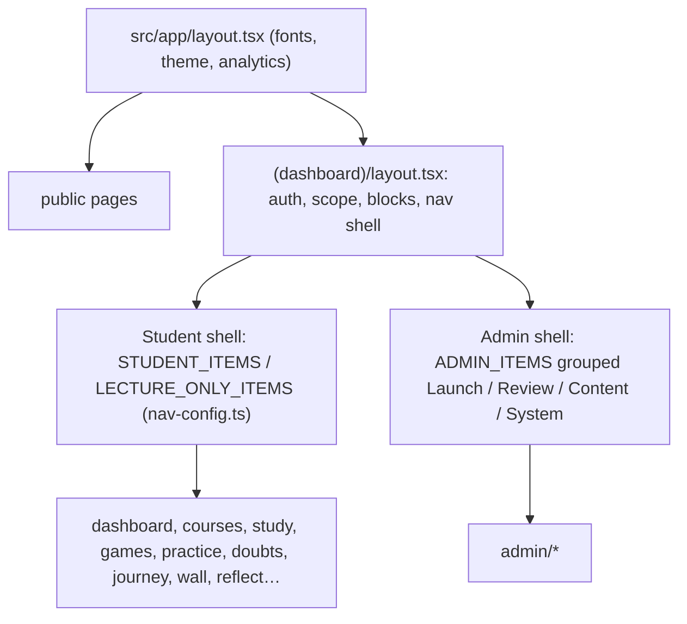

> **SUPERSEDED on 2026-11-14.** Use docs/architecture/FRONTEND.md instead. This file is kept for history and may be out of date. Index of current docs: docs/README.md.

# Frontend Architecture
> Verified against `main` @ `b2a9698`.

## Stack & conventions
Next.js 16 App Router, React 19 (strict React-Compiler-era lint rules: `react-hooks/set-state-in-effect`, `react-hooks/globals` — shared client state uses `useSyncExternalStore`), Tailwind v4 tokens (`src/app/globals.css`), Radix primitives wrapped in `src/components/ui`, icons by **string key** (`nav-config.ts` → `NAV_ICONS`) so config can cross the server/client boundary. `AGENTS.md` warns that Next 16 differs from older versions; read `node_modules/next/dist/docs/` before changing framework-level code. Design rules: `docs/UI_RULES.md`, `docs/UI_UX_GUIDELINES.md`, `/vibha-design` skill.

## Layout tree

Navigation: student primary = Home, Lectures, Notes, Games, Practice; "More" = Doubts, Leaderboard, My journey, Medicines, Journal, Wall (`src/components/navigation/nav-config.ts`). `withoutBlocked()` removes items an admin switched off for that student. Back/forward buttons: `src/components/navigation/back-forward.tsx`.

## Component areas (`src/components`)
`ui` (primitives), `design-system`, `navigation`, `app-shell.tsx`, `admin`, `course` (player, lists), `learn`/`study`/`practice`/`sim`/`meds`/`psychopharm`/`standing` (feature UIs), `landing`/`home`/`site`/`free`/`policies` (public), `analytics` (VisitTracker → `/api/visit` every ~2 min), `mobile`, `motion`.

## Data fetching pattern
Server Components call `getSession()` then query Supabase (RLS client `createClient()` or service-role `createAdminClient()`); mutations are **Server Actions** (`*actions*.ts`, `"use server"`), re-validated with `requireAdmin()`/`requireSession()`. Client components call `/api/*` only for streaming/AI/media flows. Tables not yet migrated are tolerated (feature code catches missing-table errors).

## Known frontend concerns
See [TECHNICAL_DEBT](../inventory/TECHNICAL_DEBT.md): CSP keeps `'unsafe-inline'`; many `.tsx` files over 300 lines in practice/sim; Google-font build dependency (offline build needs a local-font swap — operational note, not in repo).
