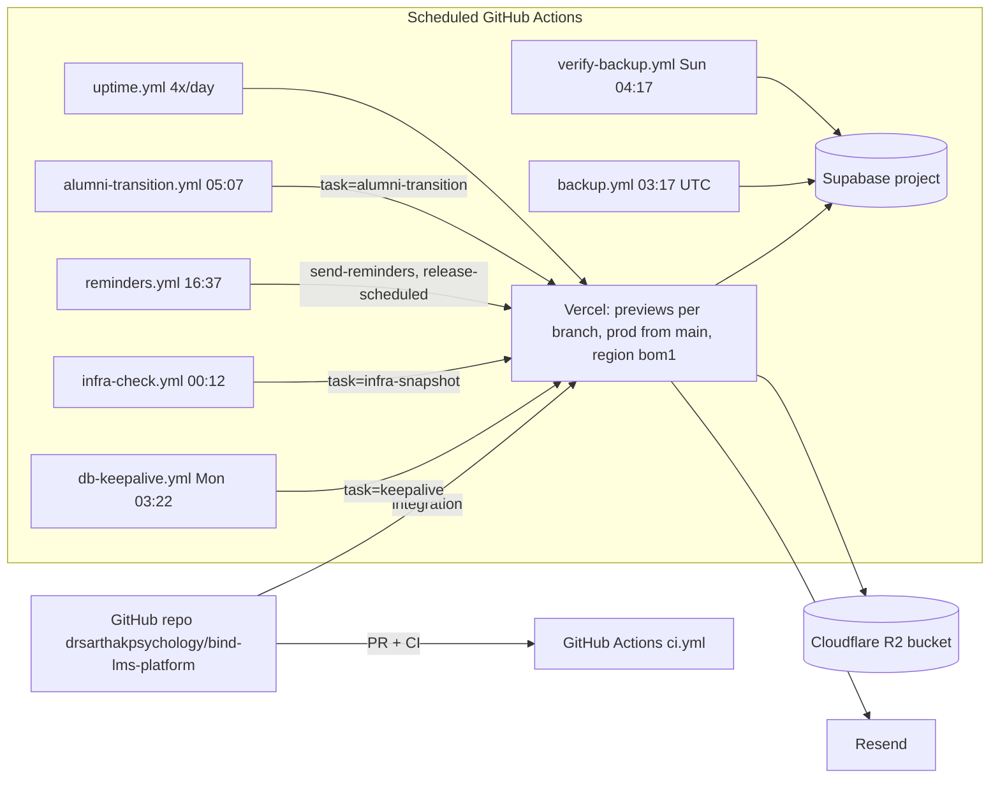

# Infrastructure & Deployment
> Verified against `main` @ `b2a9698`. Dashboard-side settings (Vercel, Supabase, Cloudflare, Resend, DNS) are **not in the repo → UNVERIFIED**.

| Item | Detail (source) |
|---|---|
| Hosting | Vercel, `regions: ["bom1"]` (`vercel.json`) |
| Build | `next build`; `outputFileTracingIncludes` ships `docs/psychopharm`, `content/policies`, `scripts/corpus/normalised` (`next.config.ts`) |
| CI | tsc, eslint, vitest, build; Playwright only if `E2E_BASE_URL` secret set (`ci.yml`) |
| Cron tasks | `keepalive, prune-logs, infra-snapshot, alumni-transition, release-scheduled, send-reminders` (`api/internal/cron/route.ts`). `prune-logs` has no workflow in `.github/workflows` → `UNVERIFIED` whether invoked elsewhere |
| Backups | nightly + weekly verification (`backup.yml`, `verify-backup.yml`, `scripts/restore.ts`, `docs/RESTORE_RUNBOOK.md`) — required GitHub secrets are `UNVERIFIED` |
| Media | R2 HLS ladder, AES-128; CORS via `scripts/set-r2-cors.ts`; key rotation `docs/R2_KEY_ROTATION.md` |
| Voice | LiveKit worker (`livekit-agent/`) deployed separately (`UNVERIFIED` where); Chatterbox TTS on AWS/Azure (`docs/CHATTERBOX_*_DEPLOY.md`) |
| Env vars | ~70 names referenced in code (see `docs/ENVIRONMENT_VARIABLES.md` for the maintained list; **values never documented**) |
