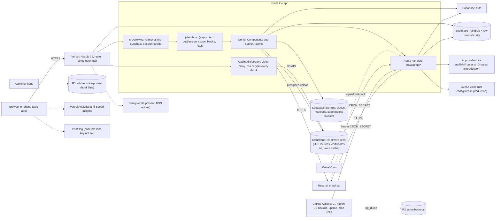

# System overview

Checked against the code on branch `admin-redesign` at commit `e4cb5ef0` and against the live services on 2026-11-14 (read-only).

## What the system is

VIBHA School of Psychology runs one Next.js 16 web app. It has two parts:

- A public site: home page, waitlist, policies, certificate check (`/verify/[id]`), free tools (`/free`), public forms (`/f/[slug]`), password setup (`/setup`).
- A signed-in app under `src/app/(dashboard)`: students, alumni and admins. Admin pages live under `/admin`.

There is no public sign-up and no payment system. Admins create accounts. Each student sets a password from a one-time link.

Live today: 126 student accounts, 1 super admin, 1 view admin (live database count, 2026-11-14).

## Diagram

## The parts

| Part | What it does | Where |
|---|---|---|
| Next.js app | All pages, server actions and API routes | `src/app`, `src/components`, `src/lib` |
| `src/proxy.ts` | Next 16 replacement for middleware. Refreshes the auth cookie, sends signed-out users to `/login`, sets `x-pathname` | `src/proxy.ts` |
| Session check | The real gate: account status, expiry, one-device rule | `src/lib/auth/session.ts` |
| Supabase | Login, Postgres database (about 170 tables), row level security, three private storage buckets | Project `hojhzwvuccojqkvkkslw`, region ap-south-1, **Free plan** |
| Cloudflare R2 | All 17 live lectures (HLS), certificate signature images, voice cache. Separate bucket for DB backups and for book files | Buckets `plms-videos`, `plms-backups`, `vibha-books-private` |
| Resend | Credential emails, campaigns, nudges, doubt follow-ups. Webhook records delivery and inbound replies | `src/lib/auth/roster.ts` (`sendResendEmail`), `src/app/api/emails/resend` |
| AI router | Picks a provider per task, fails over on errors, keeps student data on no-train providers | `src/lib/ai/router.ts`, `src/lib/ai/guards.ts` |
| Crons | Vercel Cron (3 jobs) and GitHub Actions (7 workflows) call protected endpoints | `vercel.json`, `.github/workflows/*` |

## How a request flows (signed-in page)

1. `src/proxy.ts` runs. It refreshes the Supabase cookie. No session on a protected path: redirect to `/login`.
2. `src/app/(dashboard)/layout.tsx` calls `getSession()` (cached per request with React `cache`). It reads `profiles` and compares the `plms_session` cookie with `profiles.active_session_token`.
3. Expired goes to `/expired`, blocked to `/paused`, signed in elsewhere to `/login`. A lectures-only student is sent to `/dashboard` from any path outside the allowed list.
4. The layout loads access blocks, the details form state, unread notice count and feature flags, then renders `AppShell`.
5. The page reads data with the user's Supabase client, so row level security applies. Admin writes use the service-role client after `requireSuperAdmin()`.

## Big facts a new developer must know

- **The test link and the live site share one database.** The `admin-redesign` preview uses the live Supabase project (Vercel env comment, 2026-11-06). Anything tested there writes real rows.
- **`CRON_SECRET` is not set in Vercel.** Every cron endpoint returns 401 without it, so the 3 Vercel crons (standing, monthly certificates, doubt follow-up) do nothing today. See `docs/SCALABILITY_30_TO_300.md` item 2.
- **Video bytes pass through Vercel functions.** R2 is never exposed to the browser. This is good for protection and is the main cost risk at 300 students.
- **Migrations are applied by hand.** SQL lives in `supabase/migrations_pending/` and `src/migrations_pending/`. See `DATABASE.md`.

## Where to read next

`FRONTEND.md`, `BACKEND.md`, `DATABASE.md`, `AUTH.md`, `VIDEO.md`, `STORAGE.md`, `INTEGRATIONS.md` in this folder.
