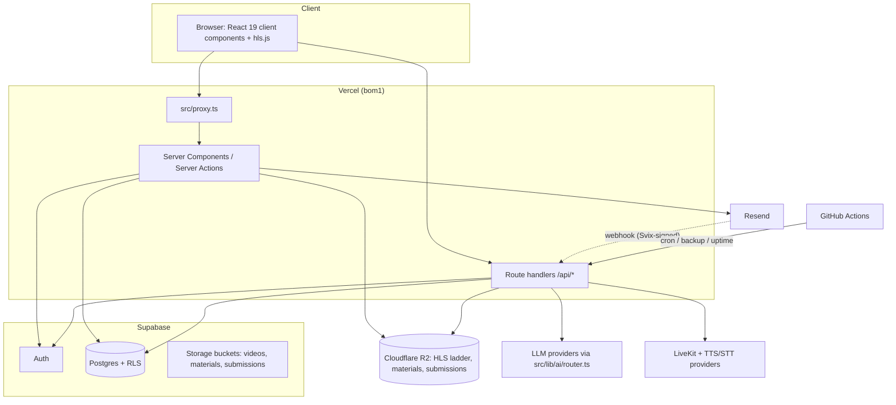
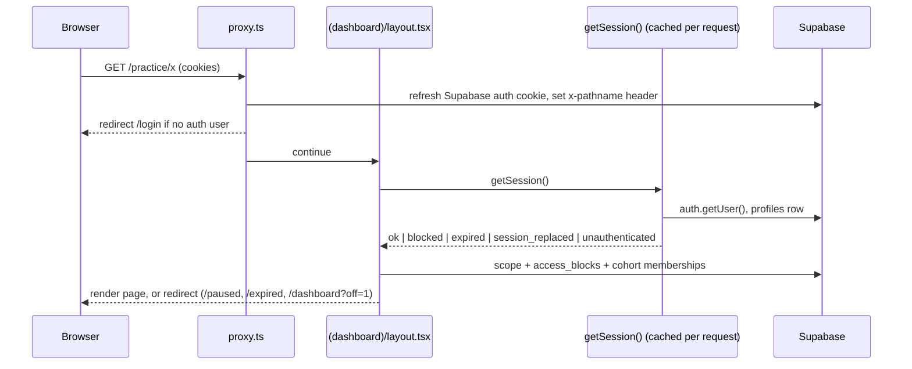
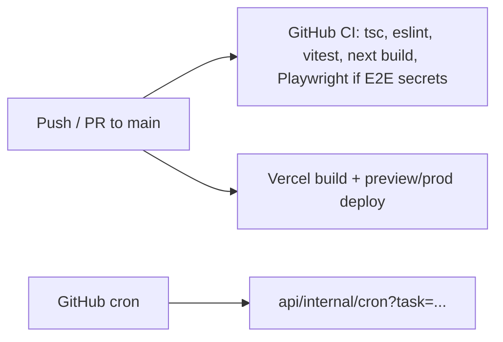

# System Architecture (diagrams)
> Verified against `main` @ `b2a9698`. Each diagram cites the code it was drawn from.

## 1. Overall system

Sources: `src/proxy.ts`, `src/lib/supabase/server.ts`, `src/lib/media/*`, `src/lib/ai/router.ts`, `.github/workflows/*`.

## 2. Request lifecycle for an authenticated page

Sources: `src/proxy.ts`, `src/lib/auth/session.ts`, `src/app/(dashboard)/layout.tsx`, `src/lib/access/*`.

## 3. Deployment/CI flow

Sources: `.github/workflows/ci.yml`, `vercel.json`. The Vercel↔GitHub integration itself is configured outside the repo (`UNVERIFIED`).

Further diagrams: auth → [AUTHENTICATION](../modules/AUTHENTICATION.md) · enrolment → [ENROLLMENT_FLOW](../workflows/ENROLLMENT_FLOW.md) · video → [VIDEO_SYSTEM](../modules/VIDEO_SYSTEM.md), [VIDEO_PROCESSING](../workflows/VIDEO_PROCESSING.md) · quizzes → [ASSESSMENT_FLOW](../workflows/ASSESSMENT_FLOW.md) · certificates → [CERTIFICATE_FLOW](../workflows/CERTIFICATE_FLOW.md) · notifications → [NOTIFICATIONS](../modules/NOTIFICATIONS.md) · data model → [DATABASE_ARCHITECTURE](DATABASE_ARCHITECTURE.md) · student/admin lifecycle → [STUDENT_LIFECYCLE](../workflows/STUDENT_LIFECYCLE.md).
