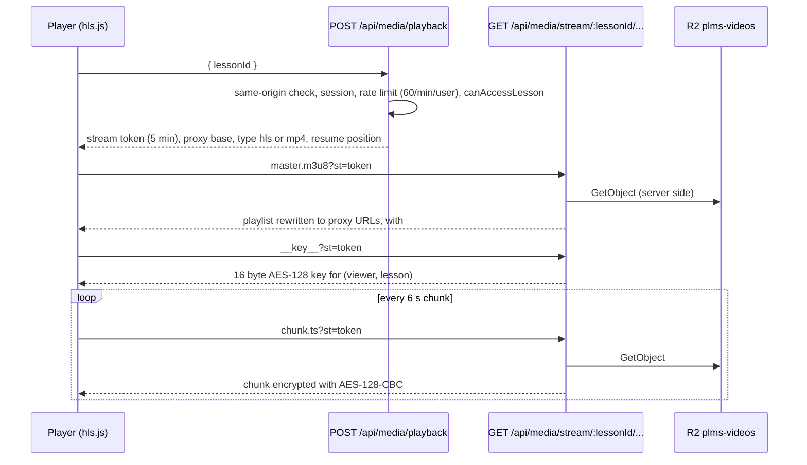

# Video

Lectures are HLS video stored in Cloudflare R2 and played through the app's own stream proxy. The browser never gets an R2 or Supabase address. Checked against commit `e4cb5ef0` and the live database on 2026-11-14.

## Live state

- 17 lessons, all with an HLS `media_assets` row in R2 bucket `plms-videos` (15 at stage `done`, 2 at `queued` but already with a playlist).
- About 29 hours of video in total. Longest lecture about 2 h 33 min.
- Bitrate ladders: 1080p, 720p, 480p and 240p or 360p (some lessons have no 1080p).
- Supabase Storage bucket `videos` still holds 3 old objects (about 150 MB). No lesson points at it.

## Upload and encoding

Two ways in:

1. **Admin upload in the browser** (`/admin/courses/[courseId]`):
   - `prepareVideoUpload` (Server Action in `src/app/(dashboard)/admin/courses/[courseId]/actions.ts`) returns a presigned R2 PUT URL (`signR2UploadUrl` in `src/lib/media/r2.ts`, 15 minutes) for `lessons/<courseId>/source/<uuid>-<name>`.
   - The browser uploads the MP4 straight to R2. Vercel never carries the upload.
   - `createLessonWithVideo` or `attachVideoToLesson` checks the object exists, writes the lesson (`video_provider = 'r2'`) and a `media_assets` row with no playlist. The lesson then plays as a single MP4 through the proxy.
2. **HLS encoding** (`npm run publish-lecture -- ./file.mp4 --lesson <id>`, `scripts/publish-lecture.ts`), run on a computer with `ffmpeg`:
   - Encodes the ladder (6 second segments), uploads to `lessons/<lessonId>/hls/` in R2, upserts `media_assets` (`provider = 'r2'`, `master_playlist`, `ladder`, `duration_seconds`).
   - Trigger `sync_lesson_video_path_on_hls` keeps `lessons.video_storage_path` in step.
   - The `stage`, `progress` and `worker_started_at` columns on `media_assets` are written by an encoding worker that is not in this repo. Ask the owner where it runs before changing them.

Other tools: `npm run media-doctor` (reports), `npm run media-promote` (marks verified rows ready), `npm run verify-r2`, `npm run set-r2-cors` (R2 CORS for browser uploads), `npm run rotate-r2` (see `docs/R2_KEY_ROTATION.md`).

## Playback

Files:

- Player: `src/app/(dashboard)/courses/[courseId]/lessons/[lessonId]/video-player.tsx` (hls.js, refreshes the token before it expires, saves progress every 10 seconds through `/api/save`).
- Token: `src/lib/media/stream-token.ts`. HMAC-SHA256 with `SESSION_SECRET`. Carries user id, lesson id, course id and expiry (5 minutes). No storage key. Fails closed when `SESSION_SECRET` is missing.
- Proxy: `src/app/api/media/stream/[...lessonId]/route.ts` (`maxDuration` 300 seconds for long MP4 streams). Checks: valid token for this lesson and user, the session cookie, enrolment and publish (cached per token in `src/lib/media/stream-cache.ts`), and a per-server rate limit. `safeStreamRest` (`src/lib/media/stream-guard.ts`) stops path tricks.
- Object lookup: `src/lib/media/proxy-client.ts` (`resolveLessonStreamFromRow`). The location comes from the database row (`media_assets.provider`, `bucket`, `key_prefix`), never from `NEXT_PUBLIC_MEDIA_PROVIDER`.

## Encryption and key derivation

`src/lib/media/crypto.ts`:

- Chunks are stored in R2 as plain MPEG-TS.
- The proxy encrypts each chunk on the way out with AES-128-CBC. The IV is the chunk's media sequence number, which is what hls.js expects.
- Key: `HMAC-SHA256(key = "plms-session-key-v2:" + lessonId, data = SESSION_SECRET + viewerId)`, first 16 bytes. It is fixed per viewer and lesson so playback keeps working when the 5 minute token rotates. The key endpoint still needs a valid token and session.
- Result: bytes copied from the network tab only work for that viewer, and fetching any of them needs a fresh token.
- Limit: no DRM. Screen recording is always possible. Accepted in the security audit.

## Delivery cost

Every chunk passes through a Vercel function (R2 to Vercel to the viewer). R2 egress is free. Vercel bandwidth and function time are not. At 300 students this is the largest cost and the first thing to watch. See `docs/SCALABILITY_30_TO_300.md` item 1.

## Materials and submissions use the same proxy idea

- `GET /api/media/materials/:materialId`: streams a course file after an enrolment check.
- `GET /api/media/submissions/:fileId`: a student's own submission file.
