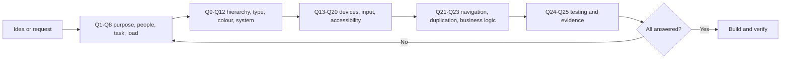

# Design decision framework (mandatory)

> **Every** new or changed component, screen, workflow or module is checked
> against these 25 questions before it merges. This applies to humans and AI
> agents alike. It is not optional.
>
> Owner requirement, 2026-11-06. Evidence lives in
> [DESIGN_INTELLIGENCE.md](DESIGN_INTELLIGENCE.md) and
> [RESEARCH_REFERENCES.md](RESEARCH_REFERENCES.md). The operational rules are
> in [UI_RULES.md](../UI_RULES.md).

## How to use it

1. Answer the questions in the PR description (copy the template below). Short answers are fine; "n/a" needs a reason.
2. Any answer that conflicts with a principle in DESIGN_INTELLIGENCE §B needs a note explaining why.
3. Q13–Q19 are answered with **evidence**: a screenshot or a test, not "should be fine".
4. A reviewer, or a second agent that didn't write the change, checks the answers against the diff.



## The 25 questions

| # | Question | What a good answer contains | Where to check |
|---|---|---|---|
| 1 | What purpose does this interface serve? | One sentence, in the user's words | — |
| 2 | Who is using it? | Role (admin, view-only admin, student, alumni, public) and how often | `requireAdmin` / `requireSuperAdmin`, RBAC docs |
| 3 | What task is the user trying to complete? | Verb + object ("reply to Priya's doubt") | — |
| 4 | What information is essential? | The ≤4 things needed to decide (working memory ≈4 **[C1]**) | DI §A3 |
| 5 | What can be revealed progressively? | What moves behind a tab, expander or "More" | DI §A12 |
| 6 | What should attract attention first? | Exactly one thing | DI §A1, principle 2 |
| 7 | What should remain visually quiet? | Everything else, named | DI §A1 |
| 8 | What cognitive effort does this interaction require? | What must be remembered between steps (should be nothing) and how many decisions | DI §A3, §A4 |
| 9 | Is the visual hierarchy clear? | Squint test passes; one H1; headings in order | UI_RULES §5 |
| 10 | Is the typography appropriate? | VIBHA scale only; weight rules in DI §F; body ≥16 px | DI §F |
| 11 | Is the colour usage meaningful? | Each colour has a role; never colour alone; contrast checked | DI §A11, WCAG 1.4.1/1.4.3/1.4.11 |
| 12 | Is it consistent with the design system? | Uses shared primitives; shape grammar (rectangle = do, pill = is, card = holds); tokens only | DI §F, `vibha-design` |
| 13 | How does it behave on desktop? | Screenshot at 1920 and 1440 | DI §D |
| 14 | How does it behave on a laptop? | Screenshot at 1470 (Mac), 1366, and 1280×600 (Windows at 150 %) | DI §D |
| 15 | How does it behave on a tablet? | Screenshot at 744, 820 portrait and 1180 landscape; touch sizing | DI §D |
| 16 | How does it behave on an iPhone? | Screenshot at 375 and 393; safe areas | DI §D |
| 17 | How does it behave on Android? | Screenshot at 360 and 412; gesture bar | DI §D |
| 18 | Does the interaction work with touch? | Targets ≥44 px on coarse pointers; no hover-only controls | DI §A6, WCAG 2.5.8 |
| 19 | Does it work with keyboard and trackpad? | Tab order, visible focus, Esc closes, shortcuts don't clash | WCAG 2.1.1, 2.4.7, 2.4.11 |
| 20 | Is it accessible? | Labels, roles, status messages announced, reduced motion, reflow at 320 px, 200 % text | WCAG 2.2 AA **[S1]** |
| 21 | Does it introduce unnecessary navigation? | Can the task finish where the user already is? | DI §A7 |
| 22 | Does it duplicate existing functionality? | Names the existing component it reuses ("one room, many doors") | DI §A13 |
| 23 | Does it preserve existing business logic? | Server rules, RBAC, rate limits, email gate, audit logs unchanged or deliberately changed | `docs/modules/*` |
| 24 | How will its usability be tested? | Unit/e2e tests + the screenshot round + who will try it | DI §I R-5 |
| 25 | What evidence supports the design decision? | Reference codes and tags (Established / Context-dependent / Hypothesis / Convention) | RESEARCH_REFERENCES |

## PR template block

Paste this into the PR description and fill it in:

```md
### Design decision framework
1 Purpose:
2 Users:
3 Task:
4 Essential info (≤4):
5 Progressive:
6 First attention:
7 Quiet:
8 Effort / memory between steps:
9 Hierarchy:
10 Type:
11 Colour:
12 System + primitives reused:
13–17 Screenshots (desktop / laptop / tablet / iPhone / Android):
18 Touch:
19 Keyboard / trackpad:
20 Accessibility:
21 Navigation added:
22 Duplicates? (component reused):
23 Business logic touched:
24 Testing:
25 Evidence (refs + tags):
```

## Exemptions

- Pure back-end changes with no visible effect: answer Q2, Q3, Q23 and Q24 only.
- Copy-only changes: Q1, Q3, Q9 and Q25.
- Emergency fixes may merge first and add the answers in the next PR, with a changelog note.
