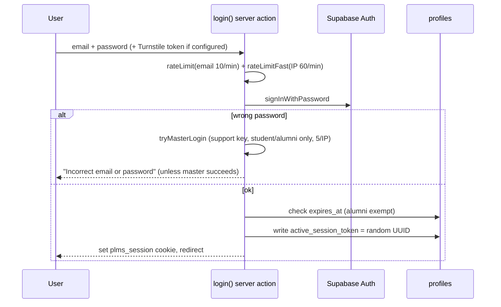

# Module: Authentication & Authorization
> Verified against `main` @ `b2a9698`. Related: [SECURITY_ARCHITECTURE](../architecture/SECURITY_ARCHITECTURE.md).

## Files
`src/lib/auth/{actions,session,guards,scope,roster,master,master-hash,master-login,api-guard,api-gate,password-policy}.ts`, `src/proxy.ts`, `src/app/login`, `src/app/set-password`, `src/app/setup`, `src/app/paused`, `src/app/expired`, `src/lib/supabase/{client,server}.ts`, `src/lib/phone.ts` (mobile normalisation), `(dashboard)/details-actions.ts` (first-login details form).

## Login flow

## Per-request check (`getSession`, cached per request)
1. `auth.getUser()` → none ⇒ `unauthenticated`.
2. load `profiles` row (role, scope, status, expires_at, active_session_token, mobile fields).
3. `status='blocked'` ⇒ `blocked` (no sign-out; unblocking restores access immediately) → `/paused`.
4. expired (non-alumni) ⇒ sign out → `/expired`.
5. cookie token ≠ `active_session_token` ⇒ sign out, `session_replaced` (single concurrent session).
## Authorization layers
`role` → `scope` (`lectureOnlyAllowed()` allows only dashboard/courses/doubts/journey/notifications) → `access_blocks` (`blockedBy()`; layout redirects to `/dashboard?off=1`) → cohort lecture rules → feature flags (`requireFeature`). See [LMS](LMS.md).
## Account creation & setup
Admin imports CSV/emails (`roster.ts`, `admin/students/bulk-import.ts`, `admin/cohorts` add-people) → account created with random credential never shown → one-time setup link (token hashed in `account_setup_tokens`, `credential_invites`) → `/set-password`. Details in [ENROLLMENT_FLOW](../workflows/ENROLLMENT_FLOW.md).
## Mobile number
`normalizeIndianMobile` strips a leading `0`s and `91` only when exactly 10 digits remain; numbers not already in the system are saved, not rejected (changed Nov 2026).
## Dependencies / regression set
Everything under `(dashboard)`; tests: `guards.test.ts`, `api-gate.test.ts`, `master-*.test.ts`, `roster.test.ts`, `phone.test.ts`, e2e `admin-access.spec.ts`, `first-time-user.spec.ts`.
