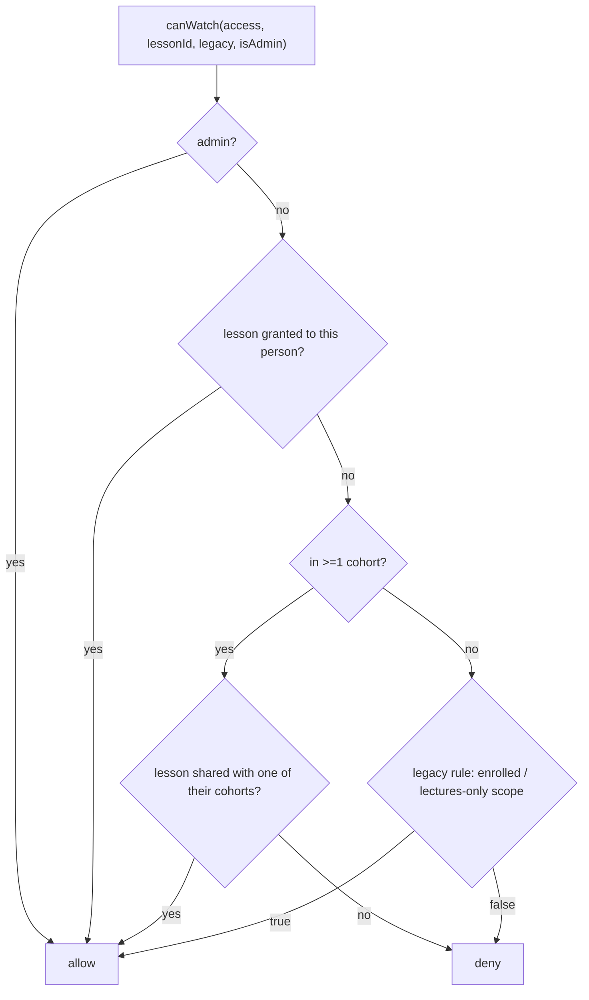

# Module: LMS — courses, lectures, cohorts, access
> Verified against `main` @ `b2a9698`. Existing note: `docs/COHORTS.md` (consistent with code at time of audit).

## Concepts
- **Course** → **Lessons** (lectures) → **Materials** (pdf/audio/image/link) and **Assignments** → **Submissions**.
- **Enrolment**: row in `course_enrollments` (`src/lib/enrollment.ts`); legacy rule when a student is in no cohort.
- **Cohort** (`cohorts`, `cohort_members`, `lesson_cohorts`, `lesson_grants`): decides who sees which lecture.

## Lecture visibility (`src/lib/cohorts/rules.ts`, loader `access.ts`) — VERIFIED

Enforced in: lecture list, lecture page, playback token (`/api/media/playback`), video stream (`/api/media/stream`). Notes, Games and Practice are not cohort-gated (only by scope/blocks/flags). Leaderboards list people who share a cohort.
## Per-student access (`src/lib/access/features.ts`, `blocks.ts`, admin `/admin/access`)
`profiles.scope` (`full`|`lectures_only`) + `access_blocks` rows keyed by feature (`notes, games, practice, medicines, rankings, doubts, journey, wall, journal, tool:<flag>`); bulk apply; "reset progress" targets tables in `RESETS` (`learn_progress, progress, sct_attempts, mse_attempts, osce_attempts, formulation_attempts, …`).
## Admin surfaces
`/admin/courses[/courseId]` (build course, upload/add lessons with cohort choice, people panel: add/remove/move between cohorts, new cohort), `/admin/cohorts[/id]`, `/admin/students`, `/admin/access`, `/admin/modules` (scheduled releases, cron `release-scheduled`).
## Doubts (Q&A board)
`src/lib/doubts/{classify,data}.ts`, `(dashboard)/doubts/*`, tables `doubts, doubt_replies, doubt_votes`. Per-cohort boards; complaints (detected by `looksLikeComplaint`) are private to the writer and admin.
## Risks
Two visibility paths (cohort vs legacy) must stay in sync; changing `rules.ts` affects lecture list, player, token and stream — regression-test all four.
