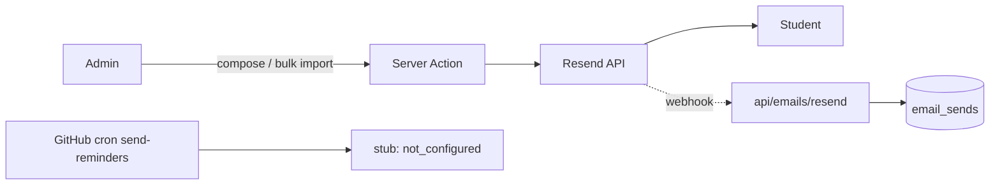

# Module: Notifications & communication
> Verified against `main` @ `b2a9698`. Flow diagram below.

| Channel | Implementation | Status |
|---|---|---|
| Credential / welcome email | `roster.ts` → Resend `fetch`; `email_sends` log; admin retry/clear failed (`admin/emails`, `failed-pick.ts`) | VERIFIED working path (needs `RESEND_API_KEY`; production key presence UNVERIFIED) |
| Admin compose to recipients | `admin/emails/compose-tab.tsx`, `recipient-picker.tsx` (students, course chips, **single-cohort chips** so one cohort's mail never reaches another) | VERIFIED |
| Delivery tracking | Resend webhook `/api/emails/resend` (Svix-verified) → `email_sends.delivered_at/…`; inbound mail table `email_inbound` | VERIFIED |
| Rate guard | `RESEND_DAILY_LIMIT` batching in `src/lib/reminders.ts` | VERIFIED code; value UNVERIFIED |
| Daily reminders | GitHub cron → `?task=send-reminders` | **STUB**: logs `not_configured`, sends nothing |
| Nudges | `/api/admin/nudge`, `/nudge/bulk` | VERIFIED route; mechanism (email vs in-app) `UNVERIFIED` |
| In-app | `/notifications` (wall replies, reports to review) | VERIFIED page |
| Push/SMS/WhatsApp | none (mobile number is collected for WhatsApp use) | G – not implemented |

