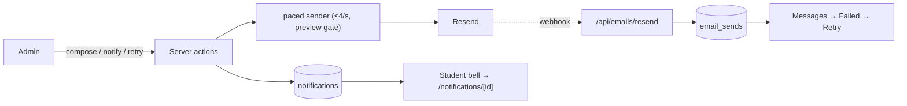

# Module: Notifications & communication
> **VERIFIED against branch `admin-redesign`**, 2026-11-06.

| Channel | Implementation | Status |
|---|---|---|
| One email sender | `sendResendEmail` in `src/lib/auth/roster.ts`: **paced to ≤ 4/second** (`createPacer`, `lib/email/pace.ts`), one automatic retry on "too many requests", **preview sites only email `ALLOWED_TEST_RECIPIENT`** (`previewBlocks`; skipped sends are not logged as failures and login links are not rotated) | VERIFIED |
| Compose | `admin/emails/compose-tab.tsx`: **Formatted** (toolbar editor `components/admin/rich-editor.tsx`, cleaned by `lib/email/rich-html.ts` → inline-styled email + plain text), **Plain text** (text-only email), **HTML** (own code); live preview; send test to me; stops a batch when the daily quota is hit | VERIFIED |
| Stored copies | `logEmailSend` keeps `html` + `retry_of` when the columns exist (`2026_11_admin_redesign.sql`), else the old row | VERIFIED |
| Failed | `admin/emails/failed-list.tsx` + `retry-actions.ts`: reasons in plain words, attempts, Retry one / ticked / all (40 per click), never twice to the same person+subject, skips people who got it later, login emails get a fresh link, stops at the daily limit, originals marked handled (`dismissed_at`, `retried_at`) | VERIFIED |
| In-app notifications | `lib/notify/send.ts` → `notifications` rows (`type` message/nudge, `body_html`, `batch_id`, `opened_at`); admin composer `admin/emails/notify-tab.tsx` (chat-like or formatted, cohort chips, "Also email it" tick box, sent list with opened counts); student bell count (`top-bar.tsx`), list `/notifications`, open full screen `/notifications/[id]` (marks read, Close) | VERIFIED code; needs DB step `2026_11_admin_redesign.sql` |
| Nudges | `lib/nudge/send.ts`: email **and** a notification (best effort) | VERIFIED |
| Achievements/certificates | `lib/achievements/notify.ts` (unchanged) | VERIFIED |
| Daily reminders | cron `send-reminders` | still a STUB |
| Push/SMS/WhatsApp | none (WhatsApp links only) | G – not built |

