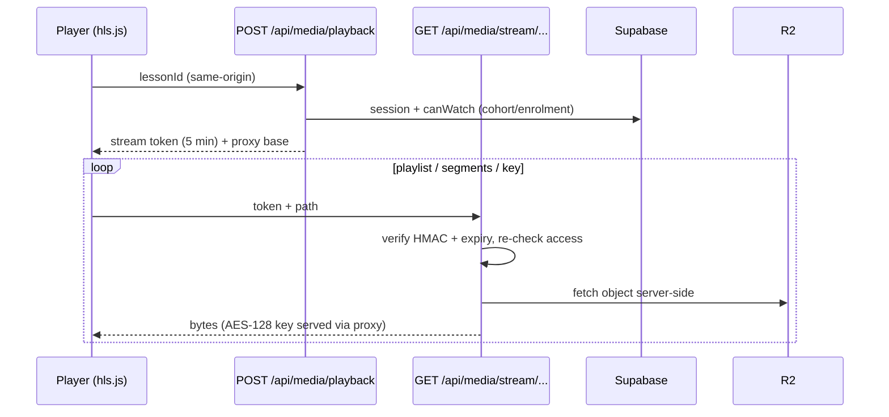

# Module: Video system
> Verified against `main` @ `b2a9698`. Pipeline walk-through: [VIDEO_PROCESSING](../workflows/VIDEO_PROCESSING.md).

## Components
| Piece | Path |
|---|---|
| Provider abstraction (`supabase` \| `r2`, env `NEXT_PUBLIC_MEDIA_PROVIDER`) | `src/lib/media/provider.ts`, `r2.ts`, `supabase.ts`, `registry.ts` |
| Playback token (HMAC, 5 min, bound to user+lesson+course; secret `SESSION_SECRET`) | `src/lib/media/stream-token.ts` |
| Same-origin gate | `src/lib/media/same-origin.ts` |
| Stream proxy (playlist + segments + AES-128 key) | `src/app/api/media/stream/[...lessonId]/route.ts`, `proxy-client.ts`, `stream-cache.ts`, `crypto.ts` |
| Materials & submissions download | `api/media/materials/[materialId]`, `api/media/submissions/[...fileId]`, `submission-paths.ts` |
| Publisher CLI | `scripts/publish-lecture.ts` (`npm run publish-lecture`) |
| Ops | `scripts/media-doctor.ts`, `media-promote.ts`, `verify-r2.ts`, `set-r2-cors.ts`, `rotate-r2.ts`, `migrate-supabase-to-r2.ts` |
| DB | `media_assets` (provider, ladder, duration; one per lesson), `lessons`, storage bucket `videos` |
| Player | `hls.js` in `src/components/course` |

## Delivery flow

Never exposed to the browser: R2 keys/URLs. Token is refreshed by the player.
## Limitations
The HLS ladder is 1080/720/480/240p, 6-second segments, tuned for talking-head + slides (script comment). `NEXT_PUBLIC_MEDIA_PROVIDER` in production is `UNVERIFIED`. DRM-grade protection is not claimed: a viewer with a valid session can still screen-record.
