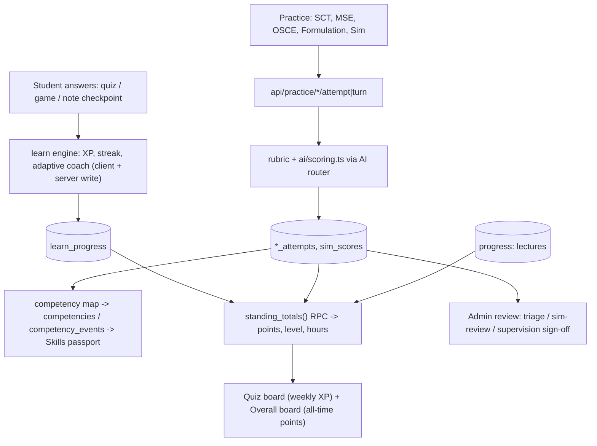

# Workflow: Assessment & scoring
> Verified against `main` @ `b2a9698`.

Sources: `src/lib/learn/*`, `src/lib/practice/*`, `src/lib/ai/scoring.ts`, `src/lib/standing/*`, `/api/practice/*`, `admin/{triage,sim-review,supervision}`. Admin corrections to AI scoring: `/api/admin/sim-corrections` → `scoring_corrections`.
