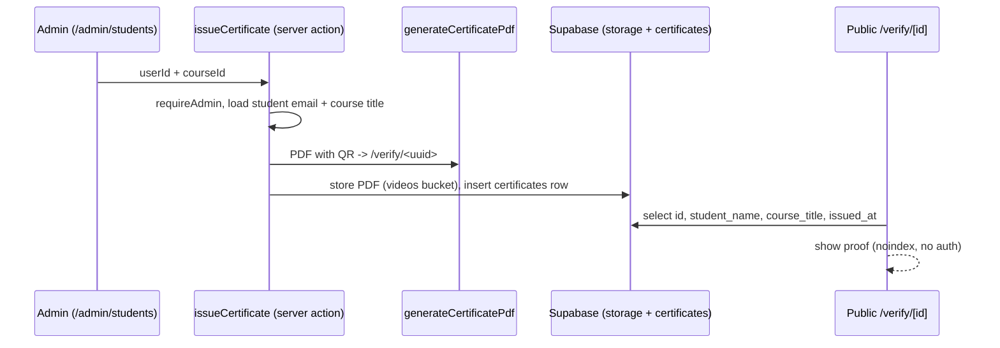

# Workflow: Certificate issuing & verification
> Verified against `main` @ `b2a9698`.

Manual trigger only; no auto-issue on completion; no email to the student; printed name = email (see [CERTIFICATES](../modules/CERTIFICATES.md)). Details of the insert/upload error handling are in the action file (`UNVERIFIED` beyond line 45).
