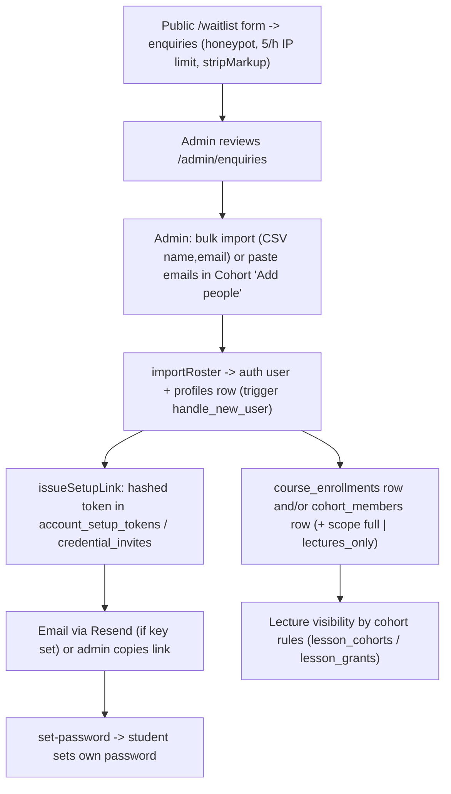

# Workflow: Enrolment & cohort placement
> Verified against `main` @ `b2a9698`. There is **no payment step**; access is granted by admins.

Sources: `src/app/waitlist/actions.ts`, `src/lib/auth/roster.ts`, `admin/students/bulk-import.ts`, `admin/cohorts/actions.ts`, `admin/courses/[courseId]/people-actions.ts`, `src/lib/enrollment.ts`, `src/lib/cohorts/rules.ts`. Students in no cohort fall back to enrolment/scope rules.
