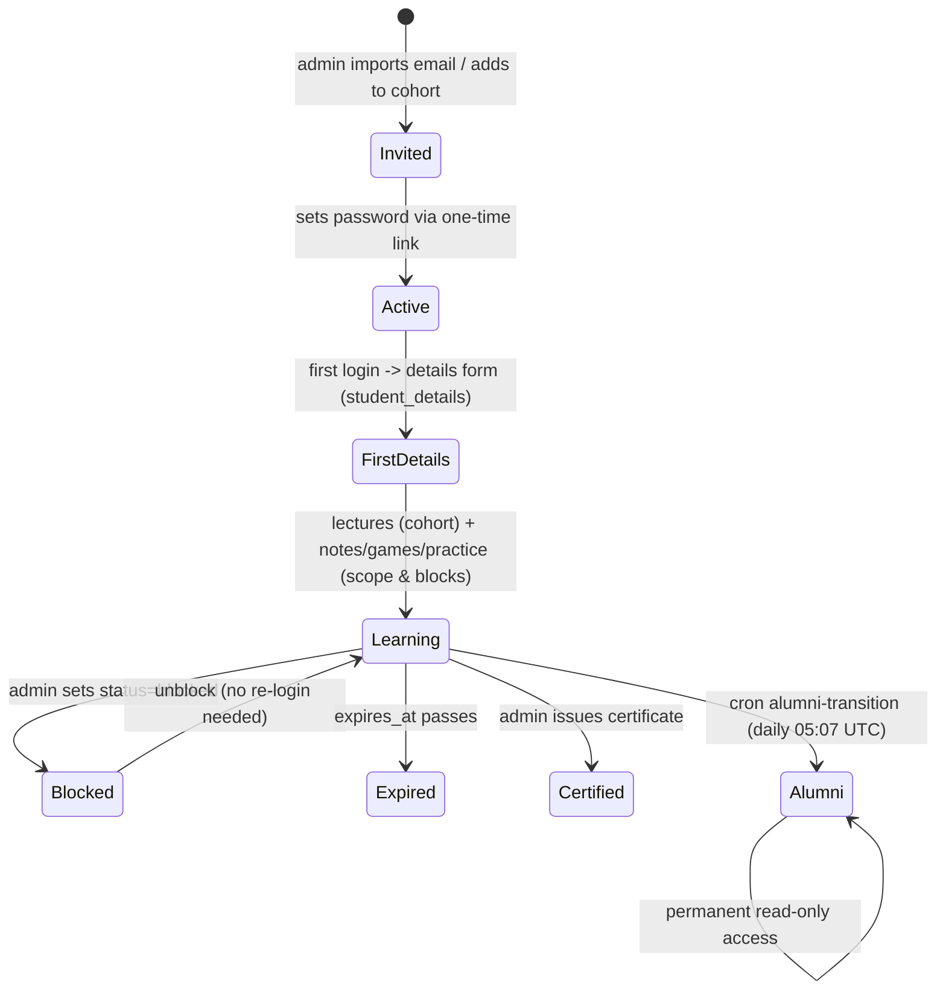

# Workflow: Student & admin lifecycle
> Verified against `main` @ `b2a9698`.

Admin lifecycle: log in → `/admin` home → import/add people → build course & upload lectures (cohort choice) → send credentials/mail → switch features in "What's live" → review submissions/sessions/sign-offs → issue certificates → monitor Activity/Pulse/Infra. Pages: [ADMIN_DASHBOARD](../modules/ADMIN_DASHBOARD.md). `UNVERIFIED`: exact `alumni-transition` criteria — read `api/internal/cron/route.ts`.
