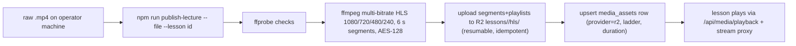

# Workflow: Video upload & processing
> Verified against `main` @ `b2a9698`, from `scripts/publish-lecture.ts`. **Processing is an operator CLI step, not an in-app upload pipeline.**

Flags: `--dry-run` (encode only), `--lesson`. Needs `ffmpeg`/`ffprobe`, R2 + Supabase env in `.env.local`. Admin UI adds the lesson record and cohort sharing; whether an in-app uploader to Supabase Storage (`videos` bucket) is still used is `UNVERIFIED` (see `NEXT_PUBLIC_MEDIA_PROVIDER`). Diagnostics: `media-doctor`, `media-promote`. Delivery: [VIDEO_SYSTEM](../modules/VIDEO_SYSTEM.md).
